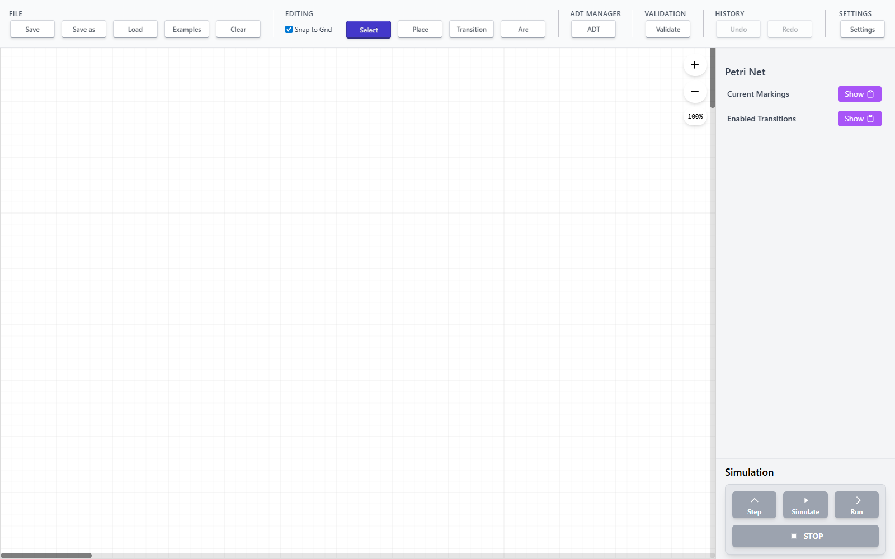
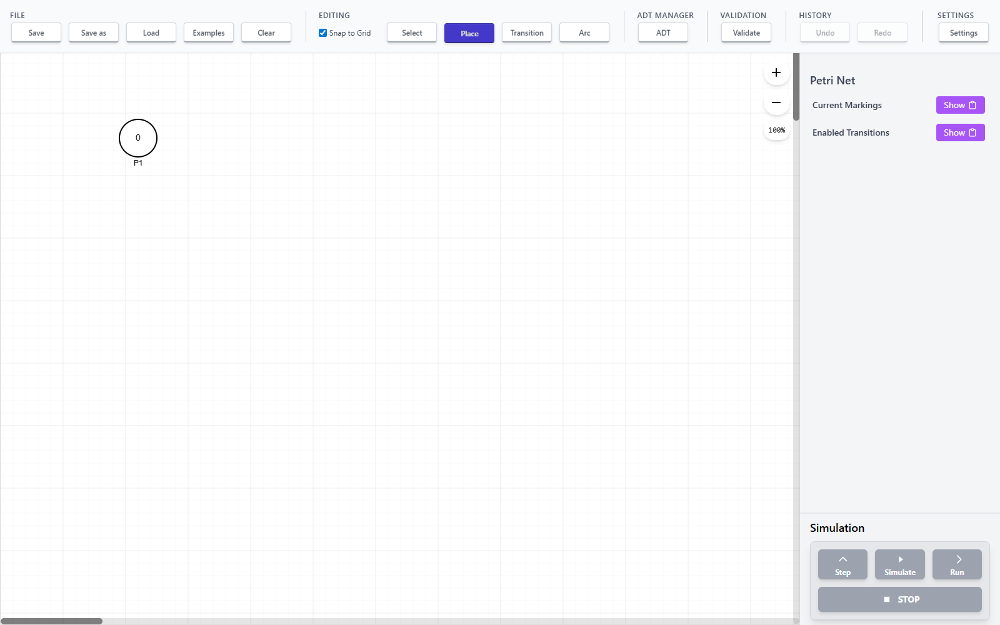
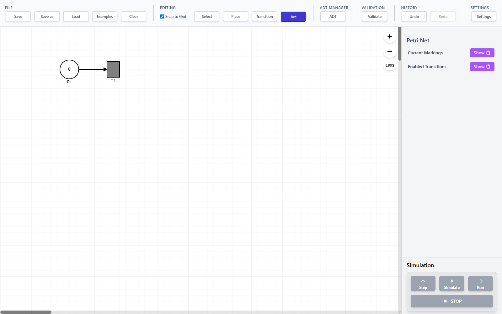

# Browser Petri Net Editor

A browser-based visual editor and simulator for **Place/Transition Petri nets** and **Algebraic Petri Nets**, built with **React**, **react-konva**, and browser-side symbolic tooling.

The project supports:
- interactive construction and editing of Petri nets in the browser
- execution and simulation of classical P/T nets
- **algebraic net** modeling with structured tokens, bindings, guards, and actions
- **PNML import/export**
- browser-side symbolic evaluation using **Z3/WebAssembly workers**

Unlike a simple diagramming tool, this editor aims to combine **formal modeling**, **interactive visualization**, and **executable semantics** in a single browser-native environment.

## Highlights

- **Visual editor** for places, transitions, arcs, labels, and markings
- **Simulation engine** for P/T nets and Algebraic Petri Nets
- **SATEL testing framework** for automated test generation and execution (Algebraic Petri Nets)
- **Single-step** and **maximal concurrent** execution modes
- **Undo/redo**, selection tools, grid snapping, zooming, and touch-friendly controls
- **PNML persistence** for saving and loading models
- **Z3-backed algebraic reasoning** in the browser for guard evaluation and symbolic terms
- **Unit and E2E test coverage** with Jest and Playwright
- **Production-grade examples** including manufacturing workflow control systems

## Screenshots & Demo

### SATEL Testing Demo

https://user-images.githubusercontent.com/satel-demo.mp4

*55-second demonstration of SATEL testing features: opening the panel, switching tabs, creating test intentions, generating tests, executing, and showing pass/fail results. [Direct link to video](docs/assets/satel-demo.mp4)*

### Editor overview



### Creating a place



### Simple Petri net on the canvas



## Why this project is interesting

Petri nets are a compact formalism for representing concurrency, synchronization, and state transitions.
This project explores what it looks like to bring that formalism into a modern browser UI while preserving executable behavior.

The result is not just a canvas editor, but a modeling environment that sits at the intersection of:

- formal methods
- simulation systems
- interactive visual tooling
- browser-based symbolic computation
- automated testing and verification

### SATEL Testing Framework

This project includes an implementation of **SATEL** (Semi-Automatic Testing Language) for Algebraic Petri Nets, based on Levi Lucio's PhD thesis (University of Geneva, 2009). SATEL provides:

- **Test intentions**: High-level behavioral specifications
- **Automatic test generation**: Generate concrete test cases from intentions
- **I/O interface**: Mark places/transitions as inputs (stimulations) or outputs (observations)
- **Test oracles**: Positive (expected) and negative (forbidden) behavior validation
- **Reduction hypotheses**: Uniformity, regularity, and axiom-based test reduction
- **Integrated UI**: Create, edit, and execute tests directly in the editor

**📺 [Watch the Demo Video](docs/assets/satel-demo.mp4)** - 55-second walkthrough of SATEL features

**📺 [SATEL V2 Demo](docs/assets/satel-v2-demo.mp4)** - Shows defining an intention with typed variables (priority: Priority under subuniformity, material: Material under uniformity) and a stimulation/observation pair, generating 3 priority cases, and executing them (historical recording; the current editor supports V2 creation).

See [SATEL guide](docs/satel/README.md) for detailed documentation and the
[unified pipeline refactoring](docs/satel/increment-12-unified-pipeline.md) for the architecture.
[Refusal tests and generation explanations](docs/satel/increment-15-generation-explanations.md)
describes the latest increments, laptop walkthrough and verification results.

The first experimental [symbolic subuniformity and oracle-validation increment](docs/satel/increment-01-symbolic-oracle.md)
is available in **SATEL → Oracle validation**, with reference and mutant APNs in Examples.
See the [GUI and V2-only review guide](docs/satel/increment-02-gui-v2.md). The CLI also supports
comparison of coarse and refined operation equations. Run it with
`cd petri-net-app && npm run satel:oracle-example`.

## Repository layout

This repository contains the application in `petri-net-app/`:

```text
Browser-Petri-Net-Editor/
├── petri-net-app/     # Vite + React application
├── docs/              # user and developer documentation
└── README.md
```

## Quick start

### Prerequisites

- Node.js (v16 or higher)
- npm (v7 or higher)

### Install

```bash
cd petri-net-app
npm install
```

### Run locally

```bash
cd petri-net-app
npm run dev
```

Open `http://localhost:3000`.

### Try SATEL Testing

1. Load **Examples → SATEL Account — Reference** (switches to Algebraic mode).
2. Open **SATEL → Oracle validation** and click **Generate and validate on loaded reference**.
3. Inspect the four admitted tests, symbolic classes, and equation provenance.
4. Close SATEL and load **SATEL Account — Mutant: reject-exact-balance**.
5. Reopen SATEL and **Replay frozen suite on loaded APN**. Inspect the failed equality case.

Create and edit intentions in **Intentions**. For built-in ADTs and shared-variable compound guards, load **SATEL Built-in types — Symbolic classes** or **SATEL Compound guard — Reference**. See the [increment 6 review guide](docs/satel/increment-06-builtins-compound-guards.md). For executable Bool/String/Pair/List calls and two-pair mutation testing, load **SATEL Typed store — Reference** and follow the [increment 7 review guide](docs/satel/increment-07-typed-methods.md).

See [SATEL guide](docs/satel/README.md) for detailed instructions.

## Documentation

- User guide: `docs/user-guide.md`
- Developer guide: `docs/developer-guide.md`
- SATEL testing guide: [SATEL guide](docs/satel/README.md)
- SATEL demo script: [docs/videos/SATEL_DEMO_SCRIPT.md](docs/videos/SATEL_DEMO_SCRIPT.md)

## Examples

### Classical Petri Nets
- Simple examples with places, transitions, and token flow
- PNML import/export demonstrations

### Algebraic Petri Nets
- **Drink Vending Machine**: Tutorial example with coin handling and product selection
- **Banking Server**: User authentication, deposits, withdrawals
- **Manufacturing Workflow**: Production-grade system with resource management, quality control, and error handling (16 places, 18 transitions, 15 test intentions)

Each example includes SATEL test intentions demonstrating comprehensive testing scenarios.

## Architecture overview

The application is split into several main concerns:

- **Editor/UI layer**: React components, canvas rendering, toolbars, panels, touch/desktop interaction
- **Document state**: places, transitions, arcs, labels, markings, history, and selection
- **Simulation layer**: common simulation core with mode-specific simulators
- **Algebraic tooling**: structured-token support, guards/actions, and browser-side Z3 integration
- **Persistence layer**: PNML import/export and local file workflows

## Project goals

This project was built to explore whether a modern browser application can support not only visual Petri net editing, but also meaningful execution semantics and symbolic reasoning.

Key goals:
- make Petri net modeling interactive and accessible
- support both classical and algebraic net variants
- preserve formal structure while providing a usable UI
- push simulation and symbolic analysis directly into the browser

## License

MIT
