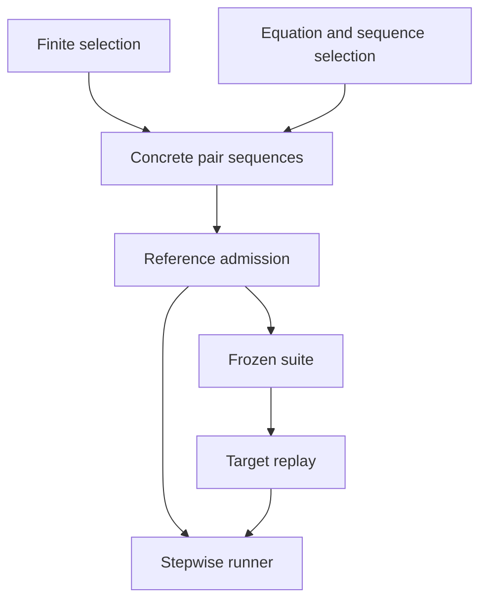

# Increment 12 — one SATEL selection, admission and replay pipeline

This increment follows the architecture review of `b19f227` on
`codex/satel-public-methods`. It does not add negative-test generation or change
the thesis assumptions about subuniformity.

## What is now shared

Both editor forms enter `deriveIntention` / `generateIntention` and produce the
same concrete test representation. A selection policy still has a distinct job:

- **Finite/fixed selection:** enumerate every declared combination that satisfies
  the intention conditions. Fixed representatives are not repaired or replaced
  with more convenient values. An unexecutable requested test rejects admission.
- **Equation selection:** derive the algebraic classes, then choose a witness in
  each class satisfying the complete APN sequence from the model initial marking.
  Blocked or unresolved classes remain visible and prevent partial admission.

Both use `admitIntention`, `validateOracleCandidates`, `replayTest` and
`runSequence`. The GUI has no separate explicit/symbolic replay branches.
`generateTestSuite`, `executeTestSuite`, `executeV2TestCase`,
`deriveSymbolicIntention` and `admitSymbolicIntention` remain compatibility entry
points into these services; they are not separate execution engines.



The original intention editor syntaxes are retained as authoring formats. The
shared model is the generated pair sequence and selection report, not a forced
conversion of all finite domains into one SMT model. Such a conversion would lose
the obligation to test every explicitly listed value.

## Observation and verdict contracts

Schema 7 concrete tests contain `pairs`, each with a fixed `stimulation`,
`observation` and explicit `assertion`:

- `required`: invoke the request and check its observation before proceeding.
- `blocked`: check that the request is disabled without firing it.

Observation scope is explicit:

- `listed`: assert only the named output places (the old explicit editor meaning).
- `public`: assert every output in the saved public interface, including empty
  bags (the equation protocol meaning).

These are **tokens produced by that firing**, not automatically the whole marking
of the place. Marking assertions remain a separate field and are checked by the
same observation checker. Bags respect multiplicity, including `contains`
marking assertions. A multiset containing one `1` cannot satisfy a request for two.
The pair display identifies observation scope in Execution details.

Replay stops on the first failing observation. A later nondeterministic call
cannot replace an established mismatch with an error. A regression uses the door
mutant: the incorrect access response at pair 2 remains a failure even when a
second enabled reset rule would make pair 3 nondeterministic. Malformed model
compilation still fails before execution; this is model validation, not a later
behavioral verdict.

Oracle admission now **requires supplied expectations**. It cannot silently use
observed outputs when expectations are missing. `observeBoundedTrace` remains an
explicit recording API, whose output is not automatically an admitted oracle.
The account audit sample now supplies independently written arithmetic expectations.
Admission replays each candidate once and saves the resulting marking evidence;
it no longer records the complete sequence and executes it a second time.

The historic `testType: negative` whole-test inversion is rejected with a
structured diagnostic. The editor no longer offers that invalid mode; opening an
old negative intention requires explicitly reviewing/converting its assertions. A disabled-request assertion is supported, but arbitrary
prefix failure is not treated as a correct negative test. This leaves room for a
future positive-prefix/forbidden-final-pair planner without pretending it exists.

## Source organization

| Responsibility | Location under `petri-net-app/src` |
|---|---|
| Common selection entry points | `satel/core/IntentionPipeline.js` |
| Fixed/finite selection policy | `satel/core/ExplicitSelection.js` |
| Equation policy and static report | `satel/core/SymbolicIntention.js` |
| Whole-sequence witness selection | `satel/core/ExecutableSequence.js` |
| Class enumeration and existential search services | `satel/core/GenericSubuniformity.js` |
| Admission | `satel/core/Admission.js` |
| Canonical test normalization and contract types | `satel/core/TestCase.js`, `Contracts.js` |
| Stepwise verdict and observation checking | `satel/core/Replay.js`, `Observations.js` |
| Continuous simulator driver | `satel/core/SequenceRunner.js` |
| Legacy transition input selection | `satel/core/DirectTransitionDriver.js` |
| Shared term parser, algebra and evaluator | `domain/algebra/` |
| Typed method compilation and semantic model identity | `domain/apn/` |
| Snapshots and structured errors | `domain/snapshots.js`, `domain/diagnostics.js` |
| GUI job lifecycle | `components/satel/hooks/useOracleSession.js` |
| Exercise scenario, expectations and mutants | `satel/examples/exercises/<scenario>.js` |

Shared APN term compilation no longer imports the SATEL intention layer. Original
module paths re-export the shared domain modules for existing callers. Built-in
sort/value checks, runtime-to-symbolic conversions and integer bounds live in
`utils/builtin-values.js`; method parsing uses the common algebra definitions.
Concrete operation evaluation remains distinct from equation evaluation and SMT
encoding, with differential tests. Sharing every evaluation implementation would
weaken their ability to catch disagreements.

Each of the ten exercises now owns its model, independent expected protocol and
mutants in a separate readable module. `builder.js` contains construction helpers;
`editor.js` is the catalog and loader. Mutation definitions still change only the
APN, never the reference expectations.

## Compilation and search

Public method signatures and typed rule plans are compiled into an immutable,
bounded semantic cache (eight definitions). Markings and layout do not enter its
key. Changing a guard, arc binding, signature or sort invalidates the definition.
Compilation does not freeze the editor's own objects. Current markings are
validated on execution even when a definition is cached.

Concrete candidate construction copies marking-bearing places, rather than
cloning the entire editor model for every binding. The existing simulator API
still carries editor-shaped nets; this increment does not replace that simulator
with a new marking-only engine. Symbolic search keeps a separate marking and
reuses the compiled rule plans throughout all classes and protocol cases.

Equation preparation is also cached separately. `findConstraintWitness` reuses the
narrowing machinery but has an existential contract: stop after one witness and
perform no class-overlap comparisons. Whole-sequence selection no longer invents
an `_executableSequence` operation and invokes full class enumeration for it.
Residual operations still undergo equation unfolding before SMT solving.

Path exploration now:

1. Reduces decidable ground constraints and rejects false prefixes.
2. Checks solver-ready prefix constraints selectively; only `unsat` prunes.
   `unknown`, undefined terms and remaining equations are not proof of infeasibility.
3. Avoids permutations of syntactically equal tokens and equal observation terms.
   Distinct occurrences are still consumed and shared-variable constraints retained.
4. Solves the complete path and tries to retain the static witness before selecting
   another witness in that same algebraic class.

Feasibility-only SMT checks no longer introduce unused variables merely because
those variables occur in result terms. Witness extraction still includes all
requested terms. This avoids unnecessary recursive datatype validity obligations.

The static decomposition is never overwritten. Selected records keep
`staticWitness`, the executable witness, selection reason and input-occurrence
trace. For the quota example, Advanced details can show static `1` and executable
`3` together. Search counters include visited nodes, pruned alternatives and
prefix solver checks.

Diagnostics carry a stage and code where available (resource limit, cancellation,
unsupported nondeterminism, interface mismatch, invalid test, and internal error).
Unexpected errors remain errors/unknown, never `unsat`. Solver unknown results
continue to block admission. No new completeness claim follows from the refactor.

## GUI lifecycle and compatibility

The session hook owns snapshots, progress, cancellation and publication. Aborted
or unmounted jobs cannot overwrite a newer session. Cancellation is cooperative:
an already-running solver check finishes or times out before its work stops.
Moving a node does not make a suite stale. Reference fingerprints include the
intentions; target fingerprints include model semantics and initial markings but
not intentions or layout. Editing the target marking still invalidates replay.

Legacy `steps` / `expected` fields remain in old exports for readers that need
them. When both those projections and canonical pairs are present, inconsistent
copies are rejected rather than choosing one silently. Prefer `pairs` in new code.

The direct-transition transport remains for older saved examples, including their
explicit initial setup. Public-method tests continue to prohibit marking overrides
and mixed direct-transition steps. Target replay always uses the target model's
own initial marking for public methods.

Two legacy tests about automatic **conditional path synthesis** are registered as
`it.failing` with the unsupported capability named in the test. They are visible
expected-failure contracts, not implemented features. Stale catalog counts and the
manufacturing success test's accidental use of the first catalog entry were fixed;
the latter now selects the supported `order-processing` intention explicitly.

## Verification and measurements

- Broad SATEL unit/integration gate: **31 suites, 278 tests** (including the two
  explicitly expected-failing legacy conditional-path tests described above).
- **46 distinct desktop/mobile browser scenarios covered successfully**: the
  broad run passed 45; one editor test timed out during a live source reload,
  then passed in a six-case focused rerun on stable source. All ten references,
  their twenty mutants, account, fulfilment and typed-method workflows were covered.
- Production build passes; the existing large-chunk warning remains.
- Five serial benchmark runs per example, plus the journal depth sweep and
  contradiction probe. **32 reference tests / 354 pairs; all 20 mutants killed;
  53 failing and 11 passing test/mutant combinations; zero execution errors.**
- New regressions cover early mismatch precedence, fixed/enumerated selection,
  missing expectations, scope equivalence, witness provenance, cache invalidation,
  caller immutability, cancellation/job ownership, token multiplicity, and legacy setup.

Raw measurements: [unified-pipeline-2026-10-16.json](performance/unified-pipeline-2026-10-16.json).
They include hashes of all measured SATEL/domain/exercise modules, environment,
individual samples, memory snapshots and mutant outcomes. The earlier baseline
is [exercises-2026-10-16.json](performance/exercises-2026-10-16.json). Both use five
serial in-process samples on the same host; the final refactoring measurement ran
without the browser checks alongside it. These are separate-run comparisons, not
a controlled statistical experiment.

Median times in milliseconds, for each complete suite:

| Example | Generate before | Generate now | Admit before | Admit now | Replay before | Replay now |
|---|---:|---:|---:|---:|---:|---:|
| thermostat | 166.88 | 138.18 | 6.99 | 3.86 | 2.30 | 2.83 |
| door | 83.60 | 58.17 | 10.50 | 7.29 | 4.04 | 7.30 |
| tickets | 120.78 | 62.04 | 5.60 | 3.78 | 2.23 | 2.84 |
| labels | 549.87 | 482.38 | 10.28 | 9.21 | 5.13 | 7.67 |
| coordinates | 331.59 | 246.32 | 17.90 | 11.79 | 7.43 | 10.48 |
| queue | 73.59 | 56.26 | 14.37 | 10.41 | 5.41 | 8.47 |
| parcel | 311.87 | 219.12 | 38.99 | 26.77 | 18.35 | 24.64 |
| quota | 451.23 | 289.61 | 19.46 | 12.92 | 9.20 | 11.43 |
| kits | 29.16 | 22.23 | 28.04 | 15.15 | 16.30 | 12.44 |
| journal | 333.17 | 246.77 | 53.23 | 30.26 | 24.15 | 25.50 |

Generation and admission improve across these samples, but replay is slightly
slower in nine cases. The unified runner additionally produces per-pair evidence
and normalizes compatibility representations. The largest replay increase here
is the parcel suite (about 6 ms). This is **not** a blanket speedup claim.

The late-contradiction kit probe changes from **1,002 visited nodes, 362.55 ms and
two unresolved classes** to **282 nodes, 15.82 ms and two disproved classes** under
the same 1,000-node / 3-second limits. No suite is admitted. Symmetry reduction
removes redundant equal-token permutations; it does not turn this into a negative
test or count it as a mutant kill. Successful journal paths retain the expected
72-to-684 visited-node progression at depths 2 through 20.

Z3 initialization was 125.77 ms, measured separately. Post-run RSS samples span
234.17–334.88 MiB; these are neither peak-memory measurements nor proof of leak
freedom. A first refactoring measurement exposed excessive periodic prefix-SMT
checks. The final policy checks at rule/token choice points and folds only newly
introduced constraints, avoiding that overhead on deterministic sequences.

To repeat on a laptop:

```sh
cd petri-net-app
npm ci
npm test -- --runInBand src/__tests__/satel src/satel/core/__tests__
npm run build
npm run satel:exercises -- --runs 5 --out ./exercise-results.json
npm run dev
```

In the GUI, generate either a finite intention or an equation intention, inspect
the pairs and their Execution details, then load the matching mutant and replay
the saved suite. In the quota example, inspect Classes and selection evidence to
compare the static and executable witnesses. Moving a node should leave saved
results current; changing a marking or guard should require replay.

## Remaining boundaries

- Negative-test generation, nondeterministic conformance policies, internal-method
  synchronization/exploration and automatic conditional path synthesis are not added.
- Static equation partitions still rely on bounded unfolding and the subuniformity
  hypothesis. Exhaustive semantic coverage is not proved.
- Search budgets and SMT unknown outcomes remain visible. There is no incremental
  solver stack across the entire APN search and no claim that state explosion is solved.
- Model compilation and solver setup are cached with bounded ownership; this is
  not evidence that long-lived WASM/browser memory is leak-free.
- Existing large-bundle build warnings remain; this increment changes SATEL
  architecture, not the application's general bundling strategy.
