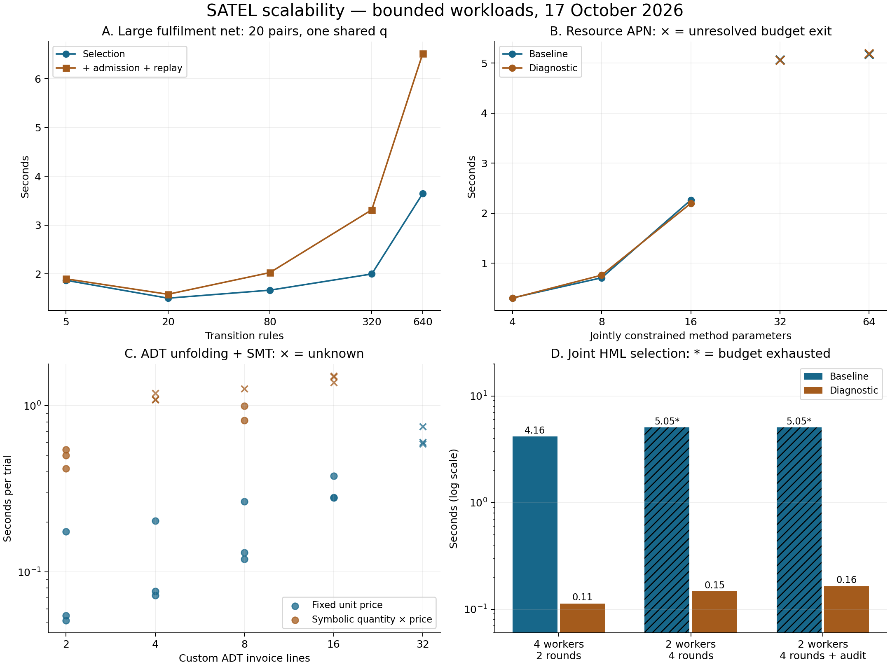

# Increment 20 — SATEL scalability experiments

17 October 2026 · branch `codex/satel-public-methods`

The approach works on sizeable **bounded, structured** APNs, but the present implementation does not yet scale reliably with many interacting symbolic parameters or deeper branching requirements. Net size alone is a poor predictor. The experiments found both genuine constraint-solving difficulty and avoidable costs in SATEL's search/SMT adapter.

We ran **237 measured trials across 79 configurations**: 62 baseline configurations and 17 configurations using a separate diagnostic patch, each repeated three times. Every selected APN test passed concrete reference admission and a further replay. Unknown, unresolved and partially unfolded results remain separate from successful selection and proved infeasibility.

## Main results

Times below are median **selection** times, excluding initialization, model construction, reference admission and replay. The complete [measurement table](performance/scaling-summary.md), [CSV](performance/scaling-summary.csv) and raw JSON retain all trials and stages.

| Workload, baseline implementation | Result across three trials | Median selection time |
|---|---|---:|
| Fulfilment: 1,923 places, 640 rules, 6,912 arcs, 20 pairs | Selected and reference-validated every time | 3.65 s |
| Fulfilment: 4 sites, 30 pairs | Selected and reference-validated every time | 3.14 s |
| Coupled resource APN: 4 / 8 / 16 symbolic quantities | Selected and reference-validated every time | 0.31 / 0.71 / 2.26 s |
| Coupled resource APN: 32 / 64 symbolic quantities | Generation time budget exhausted every time | 5.07 / 5.17 s to stop |
| Custom invoice ADT, fixed prices: 4 / 8 / 16 lines | SAT every time | 0.077 / 0.131 / 0.281 s |
| Custom invoice ADT, 32 fixed-price lines | Unfolding budget exhausted every time | 0.604 s to stop |
| Custom invoice ADT, 4 symbolic quantity × price terms | Unknown every time at the query budget | 1.09 s to stop |
| Four workers, two rounds, joint HML requirement | Selected and reference-validated every time | 4.16 s |
| Two workers, four rounds, joint HML requirement | Generation budget exhausted every time | 5.05 s to stop |



Panels A, B and D show medians; panel C shows individual trials. Crosses and hatched bars denote incomplete results, not fast successful solves. “Diagnostic” means the combined experimental patch described below, not the implementation on the working branch. An editable [SVG](performance/scaling-2026-10-17.svg) is also retained.

The largest net needed a median **6.66 s for the measured construction + selection + admission + replay stages**, plus approximately 0.3 s for Z3 initialization/warm-up. Its process peak RSS reached **661 MiB**. This includes the Node/WASM runtime, caches, repeated trials and replay; it is not the solver's incremental memory footprint or a memory-leak measurement.

## Models that approximate real functionality

The [27 loadable PNML files](performance/models/README.md) contain eight references and nineteen mutants. Each reference contains an editable intention. They are generated by `src/satel/examples/scale/models.js`, not hand-written large XML files.

### Regional fulfilment

An order follows reserve → pack → dispatch → deliver → settle. Reservations debit stock and wallet, check an enabled flag and a typed permit, validate a String label, and enforce multiple resource policies. Delivery returns the quantity and a Pair containing label/quantity. State is carried through all five calls. Dispatch requires a quantity of at least three, so the complete path must refine the static class `1 ≤ q ≤ 5`.

We vary regions (1–128), resource policies per region (2–64), and sequence length (5–30 pairs). At 128 regions there are 640 rules implementing five shared public method signatures. At four regions, increasing policies from 2 to 32 increases median selection from 1.26 s to 3.72 s; 64 policies exhaust the five-second budget.

**Scope of this result:** the 20-pair intention processes four orders and shares one symbolic quantity across them. Site IDs and labels are fixed. Most regions are inactive in that test. This measures large-model overhead and long stateful paths, not 128 simultaneously interacting symbolic orders. Each region has one outstanding order; payment networks, clocks, transport failures, fairness and asynchronous distributed protocols are absent.

Mutants disable dispatch, return a wrong receipt quantity, or omit the stock debit. The first two are detected. **The stock-debit mutant survives:** public observations do not inspect remaining stock, and these bounded orders do not exhaust it. This is a useful coverage gap. A follow-up depletion/refusal intention or an explicit stock observation is needed to expose it.

### Coupled resource allocator

This addresses the single-variable limitation above. One method accepts a vector of 4–64 independently symbolic Int quantities. Each quantity must fit the available input-place stock; neighboring quantities satisfy two coupling inequalities; their total must equal a target. The transition debits every stock and stores the exact List allocation. A second method confirms that List. All-ten is a planted feasible solution, but the generator must solve the constraints itself.

Sixteen parameters take 67 solver-adapter calls and about 2.26 s. At 32 and 64 parameters the baseline runs exhaust generation time despite the recorded checks returning SAT/UNSAT, with **no unknown solver result**. This exposes repeated checking and constraint processing as a bottleneck, rather than demonstrating that the underlying arithmetic is beyond Z3. The diagnostic patch does not materially improve this family. Mutants disable confirmation or truncate the returned allocation; both fail the selected eight-resource test.

### Replicated worker service and HML

Any of several rules can accept the same Pair-valued job. The requirement is, recursively, “every acceptance has a completion returning that job.” The last worker requires its integer field to be at least three. Joint selection must find a shared parameter that satisfies every relevant branch.

An optional List audit records the chosen worker each round. Without it, equal full markings can be memoized; with it, histories remain distinct. For two workers/two rounds the HML construction records seven formula/state nodes without audit, thirteen with audit. At two workers/four rounds, the diagnostic run records thirteen versus sixty-one nodes. The property does not inspect audit, so this also identifies an opportunity for a **justified** observation-preserving abstraction; simply dropping state is not generally sound.

The pair protocol has **two pairs**; the additional HML requirement ranges up to **sixteen nested modalities**. These are different depth measures. Larger branching configurations hit construction-work or expanded-constraint-size limits even when the net itself is tiny. Missing-worker and wrong-receipt mutants are detected wherever selection completes.

These are executable bounded abstractions of services, not validated industrial case studies. They retain initial markings, typed input-arc binding, shared variables, state updates and concrete replay. This study varies enabled rules and state histories; it does not isolate scaling in the number of competing tokens within a single multiset place.

## Custom ADTs and direct solver stress

Custom ADT workloads use the actual algebraic narrowing/class derivation and Z3 adapter. **They are analysis benchmarks, not custom-sort public APN method execution.** The executable APNs above use supported built-in Int/Nat/Bool/String/Pair/List values. Runtime support for arbitrary custom sorts remains a separate increment.

The invoice algebra defines `Line(Int, Int)` and recursive `Lines = End | More(Line, Lines)`, with:

```text
total(End()) = 0
total(More(Line(q, price), rest)) = q * price + total(rest)
```

A known constructor spine is unfolded into arithmetic constraints. With fixed price ten, the remaining arithmetic is linear. Sixteen lines solve in 0.281 s. Thirty-two lines need **33 equation expansions**, including the terminal `End`, and exhaust the configured allowance of 32. This is an explicit bound, not evidence that larger lists are intrinsically unsolvable.

When both quantity and price are symbolic, bounded nonlinear integer arithmetic becomes much harder: two lines solve; four and sixteen return unknown in every baseline trial; eight solve twice and return unknown once. Thus there is **no monotonic size threshold** in these measurements. A diagnostic run with a three-second query limit solves four lines, but changes both code and budget, so it is not a clean optimization comparison.

Unknown-shape recursive Lists and Trees exercise actual subuniformity class unfolding. List budgets of 2, 4, 8 and 16 produce that many resolved constructor classes plus one residual frontier, taking 0.032, 0.081, 0.277 and 0.662 s. At sixteen classes, 120 pairwise overlap checks contribute to 153 adapter calls. Coverage remains `not-proved`.

Trees grow faster: budget six produces four resolved classes and twenty residuals. The diagnostic budget-ten run hits the 256-branch allowance, producing six resolved classes and 123 residuals. Raising the unfolding allowance to sixteen yields only one resolved class before the branch allowance is spent. This is evidence of search-order/budget interaction, not a smaller mathematical partition. The allowance counts equation unfoldings, not ordinary tree height.

Direct SMT controls include:

- Linear resource constraints up to 2,048 declared integers and 5,119 conditions. At 128 variables the baseline loses a previously found SAT result during preferred-witness handling; at 512 and 2,048 variables it hits the one-second query budget.
- All-different slot assignment. Feasible sixteen-slot instances solve in 0.123 s. The infeasible four-jobs/three-slots control is proved UNSAT in 0.019 s, but eight-jobs/seven-slots remains unknown at both the baseline one-second and diagnostic three-second query limits. The encoding uses pairwise inequalities, not a specialized scheduling solver.

The direct linear workload uses cumulative-sum auxiliary variables; the APN uses a summed guard expression. They test related constraints with different encodings, and their times must not be treated as interchangeable.

## Diagnosed implementation bottlenecks

A separate detached checkout applied the retained [diagnostic patch](performance/diagnostic-optimizations.patch). At the time of this study these changes were not applied to the primary branch. [Increment 22](increment-22-solver-reliability.md) subsequently implements and tests production versions, including retention of validated witnesses rather than disabling preferences. The historical diagnostic results below must not be presented as measurements of that later implementation:

1. **Prefix constructor typing.** Prefix checks sent Pair fields as raw String/Int values to a Pair constructor expecting tagged `Any` fields. A representative fulfilment run recorded 28 encoding-error/unknown checks out of 136 calls. Final selection uses the correctly elaborated representation and concrete admission passes, but prefix pruning loses information. Applying existing elaboration before prefix checking removes those observed encoding errors. It does not automatically make the whole workload faster.
2. **Boolean expansion in witness search.** A solver-ready HML condition was split while an unrelated residual algebraic call remained elsewhere in the query. The experimental change preserves each individually solver-ready condition. Class enumeration still splits the required cases. This targets repeated feasibility queries and Boolean expansion without changing the requested property.
3. **Preferred witness re-solving.** The adapter tries assigning every numeric variable one after finding SAT, then checks again if that preference fails. That restoration can time out and return unknown despite an earlier SAT result. The diagnostic simply disables the preference. A production fix should retain and independently validate the original model before attempting optional preferences.

| Same-budget comparison | Baseline | Combined diagnostic patch |
|---|---:|---:|
| Four workers/two rounds | 4.159 s, 237 adapter calls | 0.113 s, 9 calls; reference/mutants correct |
| Two workers/four rounds | Unresolved after 5.048 s | Selected in 0.147 s, 9 calls |
| Two workers/four rounds with audit | Unresolved after 5.053 s | Selected in 0.164 s, 9 calls |
| Direct linear allocation, 128 variables | Unknown after preference restoration | SAT in 0.179 s |
| Coupled resource APN, 16 parameters | 2.264 s | 2.197 s |
| Fulfilment, four sites/eight policies | 1.501 s | 1.948 s |

The four-worker improvement is about 37× for these three-trial medians. **It is not a general speedup claim, and the combined experiment does not isolate each change's causal contribution.** The last two rows show that the patch is not a universal improvement. Sixty-four policies still hit a Boolean-expansion allowance even with a twelve-second sequence allowance. Four workers/four rounds with audit still hit the HML construction-work limit. Memoized states can still become duplicated formula subtrees during expanded constraint construction.

## Method and validity limits

The runner launches one isolated child per configuration, sequentially. Each child initializes Z3 and executes a trivial warm-up query, then runs three measured trials. The first trial has cold model caches; later trials reuse process caches. New solver instances are created for queries. Timings are wall-clock measurements on a shared Linux x64 host reporting AMD EPYC 9V74, nine logical CPUs, Node 24.19.0. There was no CPU pinning, dedicated-host isolation or randomized trial order. These are descriptive engineering measurements, not publication-grade confidence intervals or laptop latency predictions.

Baseline allowances: 1,000 ms **per SMT check**, 4,000 ms algebraic search, 256 algebraic/Boolean expansions, 5,000 ms sequence search, 100,000 sequence-search visits, and 4,000 ms HML construction. Other HML defaults are 10,000 work units, 2,000 formula/state nodes and 100,000 expanded constraint-size units. A call can exceed one second because it includes several checks, encoding, model extraction and independent validation. Cooperative search deadlines can be exceeded by a running check. A parent hard timeout was 30 seconds per configuration, 45 seconds for the main diagnostic sweep; none was hit.

The recorded `solver.adapterMs` includes SMT encoding, solver checks, model extraction and independent checking; it is **not native Z3 search time alone**. `maxVariables` is the entire sort environment, which may contain unused fresh names; `maxDeclaredVariables` counts variables actually needed by that query. Stage times exclude plotting, exporting, mutation controls and initialization. Peak process RSS may include mutation controls on the first trial. There is no claim about sustained server throughput, GUI rendering of huge nets, cancellation latency, long-running memory growth or unbounded completeness/bisimulation.

Source hashes are retained in every raw report. The first sweep records parent HEAD `4454954` with a dirty tree containing recovered increment-19 sources and benchmark additions, subsequently preserved in `8766d00`. Therefore `4454954` alone is **not** the measured code. Later sweeps record `8766d00` plus their source hashes and dirty status. See [increment 19](increment-19-algebraic-hml-selection.md) for recovery provenance. Diagnostic files record changed core hashes and the patch makes those changes reviewable.

The 75 successful APN trials each admitted and replayed one reference test. Across the sweeps, 23 first-trial mutant replays produced 20 failures and three expected stock-leak survivors. Repeated configurations mean these are **not 23 distinct mutants**. Mutation detection is evidence about these observations, not completeness of the test set. Replaying positive tests on mutants is also distinct from generating refusal-style negative tests.

Verification after adding the workloads: **37 SATEL suites / 378 tests passed**, including stock/wallet invariants, coupled quantities and mutant controls; production build passed. All 27 exported PNML files were read back with intentions, typed markings, arc bindings and public-method compilation preserved. The diagnostic variant separately passed 64 focused regression tests before the resource-allocator addition; it has not been promoted based on that limited regression set. No new browser performance measurements were made.

## Reproduce and try the models

From `petri-net-app`, with dependencies installed:

```sh
node tools/node/benchmarks/run-scale.js --runs 3 --out ../docs/satel/performance/local-baseline.json
node tools/node/benchmarks/run-scale.js --cases tools/node/benchmarks/resource-cases.json --runs 3 --out ../docs/satel/performance/local-resource.json
node tools/node/benchmarks/export-models.js
python tools/node/benchmarks/summarize-scale.py
```

The summarizer needs matplotlib and regenerates the committed tables/figure from the four dated result files; it does not rerun benchmarks. The runner also accepts `--family`, `--pilot` and `--hard-timeout-ms`. Each result is saved immediately as JSON/JSONL so incomplete runs retain finished trials. To reproduce the historical diagnostic, use a separate worktree at the baseline commit recorded in its JSON and apply the diagnostic patch there before running `diagnostic-cases.json`; do not apply it to the increment-22 implementation or mix its results with the baseline. Its explicit three-/twelve-second overrides are in that file.

For laptop review, start the app, use **Load** to open a PNML file from `docs/satel/performance/models`, then open **SATEL → Intentions** and **Generated tests**. These files are not added to the built-in Examples menu. Start with `allocation-8-resources-reference.pnml`, `fulfilment-4-sites-reference.pnml`, or `workers-audit-small-reference.pnml`. Generate on the reference, then load its matching mutant and replay the frozen suite. Large/stress files intentionally expose limits; an unresolved generation is not a failing implementation test. GUI defaults may differ from the explicit CLI budgets.

Raw records:

- [Baseline: 57 configurations / 171 trials](performance/scaling-2026-10-17.json)
- [Coupled APNs: 5 configurations / 15 trials](performance/scaling-resource-apn-2026-10-17.json)
- [Diagnostic: 12 configurations / 36 trials](performance/scaling-diagnostic-2026-10-17.json)
- [Coupled APN diagnostic: 5 configurations / 15 trials](performance/scaling-resource-diagnostic-2026-10-17.json)

## Recommended next increments

1. Fix prefix typing and preserve an independently validated SAT witness across optional preference attempts, with targeted regression cases from this study.
2. Separate class-enumeration branching from witness-only Boolean solving throughout sequence search, preserving short-circuit definedness. Remove redundant feasibility checks before increasing default budgets. The coupled allocator is the baseline for this work.
3. Preserve shared formula structure into SMT rather than expanding memoized HML results into duplicated trees. Keep the audit and non-audit worker models as paired baselines. Add multiset-token scaling separately.
4. Measure incremental solver contexts/caching and avoid unnecessary pairwise overlap checks where constructor disjointness is already established. Then extend the realistic models with several independent orders in flight, bounded retries and depletion/refusal intentions.

These results support continuing the algebraic approach: simple custom-ADT unfolding is tractable, and several current limits are implementation costs. They do not justify claiming generic scalability for arbitrary ADTs or treating every bottleneck as a reason to replace algebraic definitions with direct SMT types.
