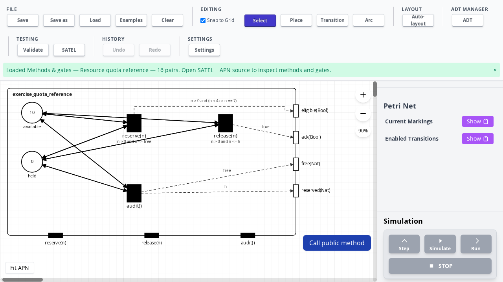

# Increment 41 — thesis graphical notation for methods and gates

30 October 2026. Branch: `codex/satel-methods-gates`.

The methods/gates examples now use the class notation shown in Figure 4.5
(printed page 55, PDF page 74) of Levi Lúcio's thesis: a boundary enclosing the
APN, black method rectangles and white gate rectangles on the boundary,
name-based synchronization between methods and internal transitions, and dashed
arrows from transitions to gates. The thesis is available from the
[University of Geneva archive](https://access.archive-ouverte.unige.ch/access/metadata/b010d34e-ad2c-4a39-8986-c0ace50e5f29/download).

## Inspect the quota example

1. Run `npm ci` and `npm run dev` in `petri-net-app` on this branch.
2. Open **Examples**, search **Methods & gates**, and select **Resource quota reference**.
3. The three black method ports are `reserve(n)`, `release(n)` and `audit()`.
   They synchronize by name with the corresponding internal transitions.
4. Four white gate ports appear on the right: `eligible(Bool)`, `ack(Bool)`,
   `free(Nat)` and `reserved(Nat)`. Dashed arrows carry each occurrence's
   argument expression. `audit()` synchronizes with both `free` and `reserved`.
5. Use **Call public method** to call `reserve(3)`. The places update and the
   gate occurrence appears in the call result. The interface remains unchanged.
6. Open **SATEL → APN source** to edit declarations or synchronization expressions.
   **Apply class** rebuilds the graphical interface. **Fit APN** fits the whole
   boundary, ports and labels into the current canvas.

## Presentation and scope

Methods are arranged along the bottom edge and gates along the right edge.
These automatic placements are a layout choice; the thesis also places ports on
other sides. Ports cannot yet be independently dragged. Internal places and
transitions retain the existing layout and drag interactions; the boundary and
synchronization arrows follow them. A method shared by several rules gets one
port. Each gate occurrence gets an arrow, including multiple outputs of one
transition. Arrow routing avoids other nodes where the available layout permits.

The old blue `With …` annotation is replaced by connections to the gate ports.
Internal transitions are black in these models; simulation highlighting still
applies. Transition guards remain visible below their names. Solid token-flow
arcs and dashed gate synchronization arrows have distinct styles.

This layer is derived from the existing method/gate metadata. It adds no places,
transitions or token-flow arcs and makes no change to execution, marking,
selection, replay or serialization semantics. All 86 converted examples use the
new view. Legacy models without gate declarations retain their previous view.
The synchronous, non-interleaved interaction assumptions in
[increment 40](increment-40-methods-gates.md) still apply.

## Validation

The graphical tests cover all 86 examples, unique method ports, gate occurrence
edges, moving transitions, unchanged semantic fingerprints, PNML round trips,
and legacy presentation. Browser checks cover the quota interaction and source
edits that add a gate, alongside the existing methods/gates and worker checks.

Recorded local results: **1,000 tests pass in 93 suites**; **10 browser checks
pass against both development and bundled applications**; production and browser
harness builds pass. The screenshot above is from the bundled application.
