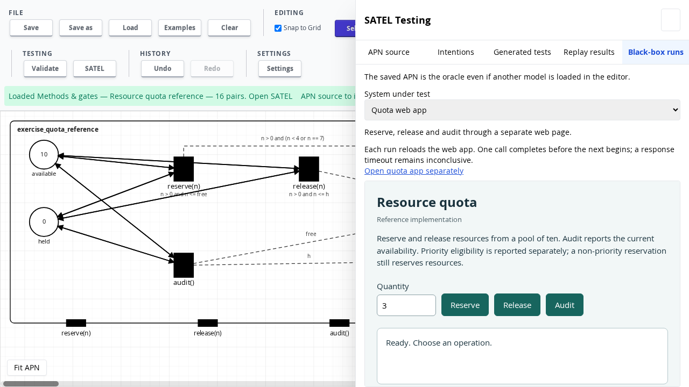
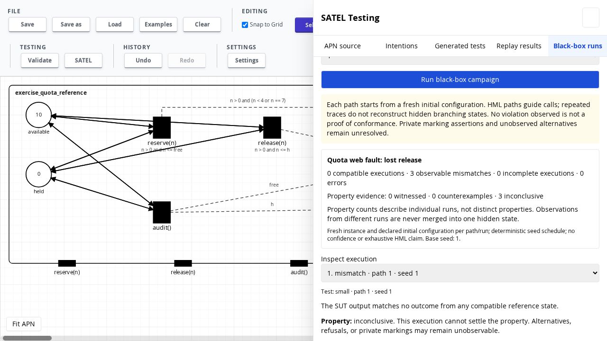

# Increment 42 — generated APN tests against a quota web SUT

30 October 2026. Branch: `codex/satel-methods-gates`.

The converted quota APN now drives a separate browser application through its
public controls. The existing black-box campaign checker uses the saved APN as
its oracle and compares typed gate occurrences after each completed interaction.
The application is implemented directly in JavaScript and imports no APN,
simulator, oracle or generated test code.

## Adapter contract

| APN interface | Browser action | Completed public response |
| --- | --- | --- |
| `reserve(n)` | Enter quantity, click Reserve | Priority eligibility → `eligible(Bool)` |
| `release(n)` | Enter quantity, click Release | Release acknowledgement → `ack(Bool)` |
| `audit()` | Click Audit | Available and held resources → `free(Nat)` and `reserved(Nat)` |

Each experiment starts by reloading the page: ten resources available, none
held. This reset creates a fresh application closure. The adapter never assigns
or reads its state. The application's audit operation is the public way to query
availability. Eligibility is a priority classification, not acceptance: reserving
four resources succeeds and returns `eligible(false)`.

Calls use named arguments (`n`) and exact JavaScript safe nonnegative integers.
The page marks each response with a request number, operation and completion
status. It publishes completion only after all public result fields are present.
Those fields expose the same typed values displayed to the user. The adapter
waits for the matching request, then maps its complete response to gate bags.
All declared gates are included, with empty bags for gates that did not occur;
ordering is immaterial and multiplicity remains significant to the checker.

Only one call may be outstanding. The page disables its buttons while working;
the adapter rejects overlapping calls. The campaign awaits a complete response
and the reference check before the next stimulation. The nominal page inserts a
25 ms delay, demonstrating that elapsed time does not require interleaving.

An explicit refusal is a completed response with no gate occurrences. A timeout
is **inconclusive**, never interpreted as refusal or an incorrect gate value.
Cancellation disconnects observation and invalidates the adapter session. Every
subsequent experiment reloads a fresh document, preventing a late response from
being reused. Malformed or missing public response fields are adapter errors.
A valid, typed value that disagrees with the APN is an observable mismatch.

The browser adapter is deliberately specific to this page. It operates a
same-origin iframe through DOM controls and a documented response-completion
marker. It does not call the service implementation directly. A remote site would
need its own completion contract and a browser automation adapter; arbitrary
cross-origin websites are not supported by this iframe adapter.

## Inspect and reproduce

1. Run `npm ci` and `npm run dev` in `petri-net-app`.
2. Load **Examples → Methods & gates → Resource quota reference**.
3. Open **SATEL → Generated tests → Generate tests**. The three admitted tests
   start with `reserve(3)`, `reserve(7)` and `reserve(4)`, each followed by a total
   of 16 method/response pairs.
4. Open **Black-box runs**, choose **Quota web app**, set runs per path to **1**,
   and run the campaign. The embedded page shows the actual SUT. The separate
   page link can be used for manual inspection.
5. Run the same suite against each **Quota web fault**. The report includes the
   failing interaction, observed gates and allowed reference responses.
6. Choose **Quota web experiment: no response** to inspect timeout handling.
7. **Download campaign evidence** saves the frozen reference, generated tests,
   observed responses and per-execution verdicts.

No additional server is required. The standalone page lives under
`petri-net-app/public/quota-sut/` and is copied into the production build. Its
relative URLs also work under an application deployment subdirectory.

## Experiment design and limits

The reference implementation and three faults are separate procedural variants:
reservation subtracts one too few resources; release fails to restore capacity;
audit overstates availability. The fourth variant never completes a response
and exercises timeout handling. The generated test inputs are not adjusted for
the faults. The expected failure points are the audit following reservation
(pair 2), the audit following release (pair 4), and the first audit (pair 2).

This is a deterministic integration experiment with deliberately injected faults.
The SUT shares an author and intended contract with the specification; it is not
independent validation of the requirements. Repetition counts do not establish
statistical confidence. A compatible observed trace does not prove conformance
or establish hidden branching structure. Existing HML evidence limitations and
reference search bounds remain in force.

## Recorded browser experiment

One run per generated test, starting with a fresh application each time:

| SUT | Compatible | Mismatches | Incomplete | First mismatch |
| --- | ---: | ---: | ---: | --- |
| Reference | 3 | 0 | 0 | — |
| Wrong reservation | 0 | 3 | 0 | Pair 2: audit |
| Lost release | 0 | 3 | 0 | Pair 4: audit |
| Wrong audit | 0 | 3 | 0 | Pair 2: audit |
| No response | 0 | 0 | 3 | Timeout; no mismatch verdict |

The reference executes all 48 interactions. For example, after `reserve(3)` and
`release(3)`, the lost-release variant reports `free(7), reserved(0)` where the
reference permits `free(10), reserved(0)`. All three injected faults are detected
by all three tests; that is nine observed mismatches across nine faulty runs.
There are no adapter errors in these runs.

The reference runs witness their existential sequence properties. The faulty
runs establish trace mismatches, while the generic trace-based HML evaluator
leaves their existential properties inconclusive: a single failed attempt does
not establish absence of all alternative executions. Those are distinct verdicts.

[Machine-readable evidence](experiments/quota-web-2026-10-30.json) preserves the
frozen reference, generated tests and complete reports. The browser tests also
exercise explicit refusal, reset isolation, timeout, cancellation/restart,
concurrent-call rejection and malformed-response handling.





Run the browser checks with:

```sh
cd petri-net-app
npx playwright test --config=playwright.satel.config.js quota-web.spec.js
```

The checks generate/admit the quota suite through the real worker-backed UI,
then exercise the application through the DOM adapter. Their downloaded evidence
is emitted under `test-results/`. For the bundled application, first run
`npx vite build --config vite.satel-test.config.js` and set `SATEL_BUILT=1` on
the Playwright command. Chromium must be installed for Playwright (or selected
with `SATEL_CHROMIUM`).

Validation: **1,012 regression tests pass in 94 suites**; **15 browser checks
pass against both development and bundled applications**. Production and browser
harness builds pass. These are local results; the existing deployment workflow
is not triggered by this branch.
